# 🏙️ Exploring a Smart City Infrastructure — Cisco Packet Tracer

This repository contains the technical documentation, microcontroller (MCU) code analysis, and network simulation of an **Internet of Things (IoT)-based Smart City** built in **Cisco Packet Tracer**. The project demonstrates how sensors, actuators, microcontrollers, Metropolitan Area Network (MAN) links, and cloud/local servers integrate to execute real-time, event-driven automation across urban subsystems.

  
   
  <b>Overview of the Smart City Metropolitan Area Network (MAN) Topology in Cisco Packet Tracer</b>

<table>
  <tr>
    <td align="center" width="50%">
      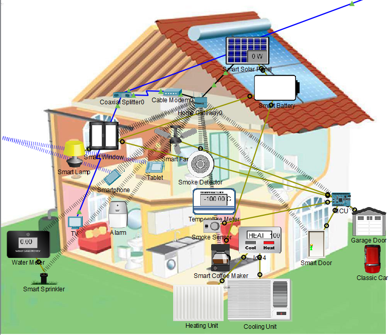 
      <b>Smart Home Cluster</b>
    </td>
    <td align="center" width="50%">
      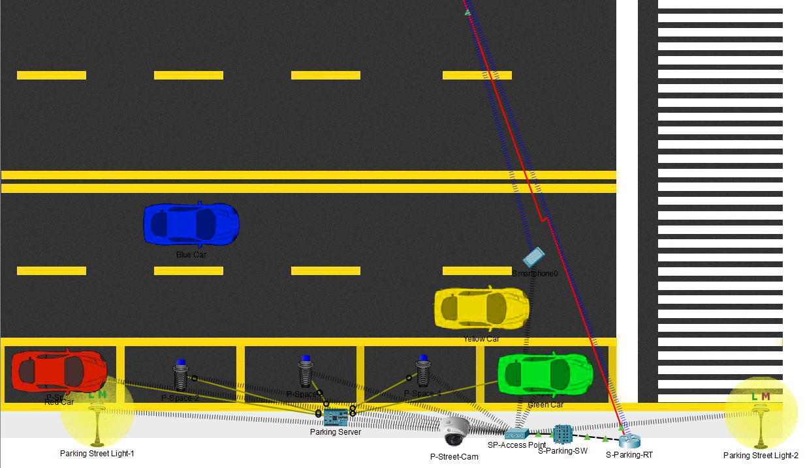 
      <b>Smart Parking Cluster</b>
    </td>
  </tr>
  <tr>
    <td align="center" width="50%">
      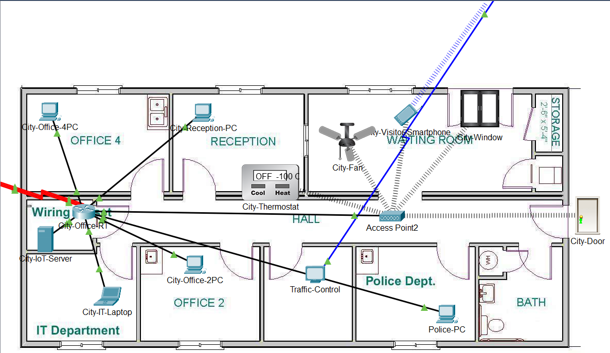 
      <b>City Offices Cluster</b>
    </td>
    <td align="center" width="50%">
      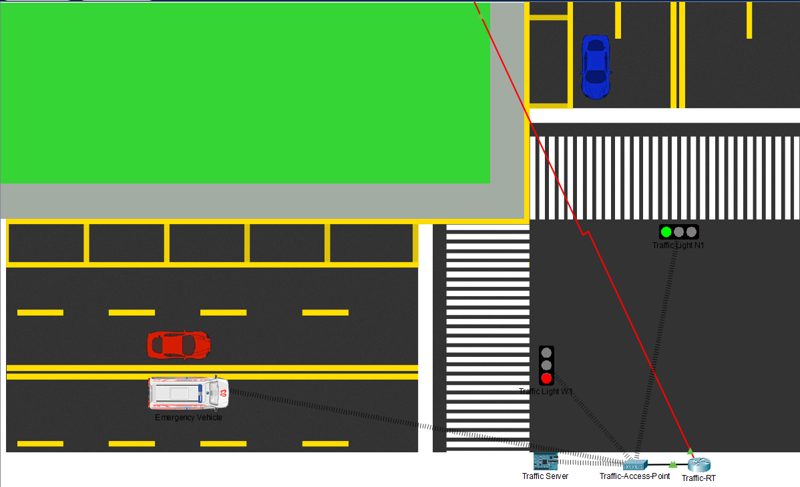 
      <b>Smart Traffic Cluster</b>
    </td>
  </tr>
</table>

---

## 📋 Table of Contents
- [Project Objectives](#-project-objectives)
- [Network Architecture & Infrastructure](#-network-architecture--infrastructure)
- [IoT Component Layers](#-iot-component-layers)
- [Subsystem & MCU Code Analysis](#-subsystem--mcu-code-analysis)
  - [1. Smart Parking](#1-smart-parking)
  - [2. Smart Traffic](#2-smart-traffic)
  - [3. Smart Home & Smart Grid](#3-smart-home--smart-grid)
- [Custom Prototype: Smart Chair](#-custom-prototype-smart-chair)
- [Subsystem Verification Summary](#-subsystem-verification-summary)
- [Simulation File](#-simulation-file)

---

## 🎯 Project Objectives
1. Analyze inter-cluster communication architectures within a Smart City Metropolitan Area Network (MAN).
2. Evaluate the integration of centralized cloud servers, DNS/HTTP services, and embedded web servers running directly on microcontrollers.
3. Inspect and document JavaScript-based event-driven IoT scripts executed on `PT-MCU` units.
4. Design and implement a custom IoT device prototype (**Smart Chair**) complete with hardware I/O pin mapping and control logic.

---

## 🌐 Network Architecture & Infrastructure

The simulated Smart City operates as a **Metropolitan Area Network (MAN)** interconnecting local urban clusters through an **ISP Cloud** using three primary transmission media:

- **ISP Cloud (Core Infrastructure):**
  - `ISP-Main-RT`: Core WAN router providing inter-cluster routing and direct serial links.
  - `Central Office Server0`: Core cellular/wireless network server connected to the cell tower (`Cell-Tower`).
  - `DNS-HTTP-Server`: Server providing Domain Name System (DNS) resolution and HTTP web hosting.
  - `Cloud0 & Coaxial Splitter`: Coaxial broadband distribution nodes.

  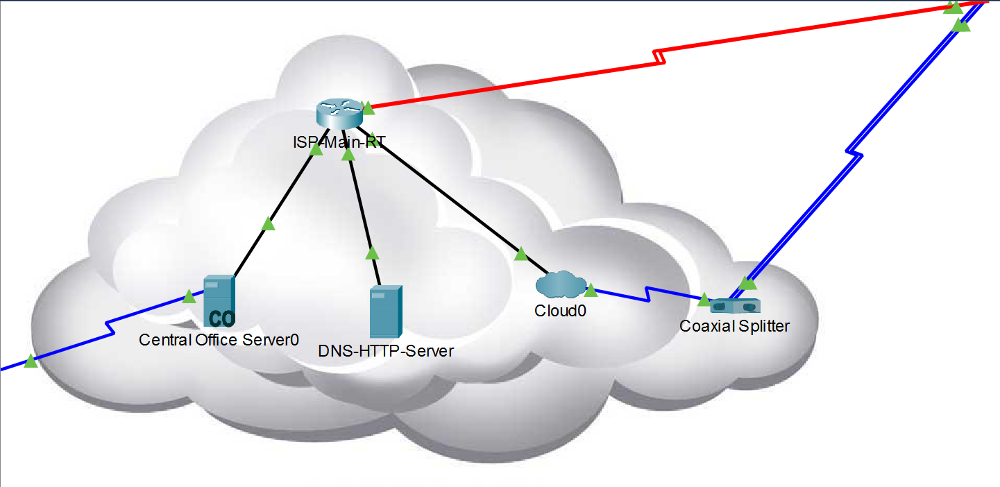
   
  <b>ISP Cloud Core Infrastructure:</b> WAN Routing, Cellular Central Office, DNS/HTTP & Coaxial Distribution

- **Inter-Cluster Transmission Media Mapping:**

| Transmission Medium | Connected Clusters / Devices | Primary Function |
| :--- | :--- | :--- |
| **Red Serial Cable** *(WAN Serial)* | `Smart Grid`, `City Offices` (to ISP Cloud); `Smart Parking`, `Smart Traffic` (to City Offices) | Centralized WAN links carrying operational office network traffic (`City-Office-RT`). |
| **Blue Coaxial Cable** *(Broadband)* | `Smart Home`, `City Offices` (to `Traffic-Control` PC), `Cell-Tower` | Dedicated high-bandwidth broadband link for real-time data streams (such as traffic CCTV feeds) without congesting the office LAN. |
| **Cellular Wireless** *(Wireless)* | `Smart Home` (Smartphones & Tablets), `Smart Parking` (Smartphones), `City Offices` | Mobile network access for citizens and city personnel via `Cell-Tower`. |

---

## 🧩 IoT Component Layers

The simulation architecture is organized into **5 functional layers** (relying on `PT-MCU` units and built-in IoT modules rather than dedicated Single Board Computers):

1. **Sensors:** PT Metal Sensor (`P-Space`), Temperature Meter, Smoke Detector, Power Meters, CO Detector, and Water Meter.
2. **Actuators:** Traffic Light, Street Light, Garage Door, Smart Fan, Smart Sprinkler, and Smart Power Grid Switch.
3. **Controllers / Microcontrollers (`PT-MCU`):** Executes event-driven JavaScript code to poll sensor states and drive actuators.
4. **Network Infrastructure:** WAN Routers (`ISP-Main-RT`, `City-Office-RT`, `Wind_RT`), Access Points, Switches, Cable Modems, Coaxial Splitters, and Cell Towers.
5. **Servers & Cloud Services:** `City-IoT-Server` (`195.0.0.2`), `DNS-HTTP-Server`, MCU Local Web Server (`10.10.10.10`), and `Power IoT Server` (`100.2.0.2`).

---

## ⚙️ Subsystem & MCU Code Analysis

### 1. Smart Parking
This cluster implements a dual-interface monitoring architecture for city administrators and commuters:
- **Administrator Dashboard (`195.0.0.2`):** Accessed via `City-IT-Laptop` (`Park` / `Park`). When parking slot `P-Space-1` is vacant, `Metal Detection` reads `0`; when a vehicle is placed on the slot, the sensor value changes to `20` (*occupied*).
- **Citizen Web Portal (`10.10.10.10`):** Accessed via a `Smartphone` web browser connecting directly to the **Embedded HTTP Server** hosted on the `PT-MCU` (Port `80`).
- **MCU Script Mechanism (`main.js`):**
  - Polls 5 metal sensors on digital pins `0` through `4` using `digitalRead()` every 5 seconds (`delay(5000)`).
  - Dynamically renders the **City Parking Manager** HTML interface (green `#00ff00` for *free*, red `#ff0000` for *taken*) with a client-side auto-refresh script running every 1 second (`1000 ms`).
  - *Code Observation:* In the base simulation script, variable `p5_div` contains a minor HTML attribute typo (`id="p4"` instead of `id="p5"`), though visual status indicators render accurately via inline CSS styling.

<table>
  <tr>
    <td align="center" width="50%">
      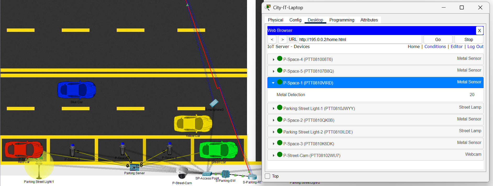 
      <b>Admin Dashboard (<code>195.0.0.2</code>):</b> <code>P-Space-1</code> Metal Detection = <code>20</code>
    </td>
    <td align="center" width="50%">
      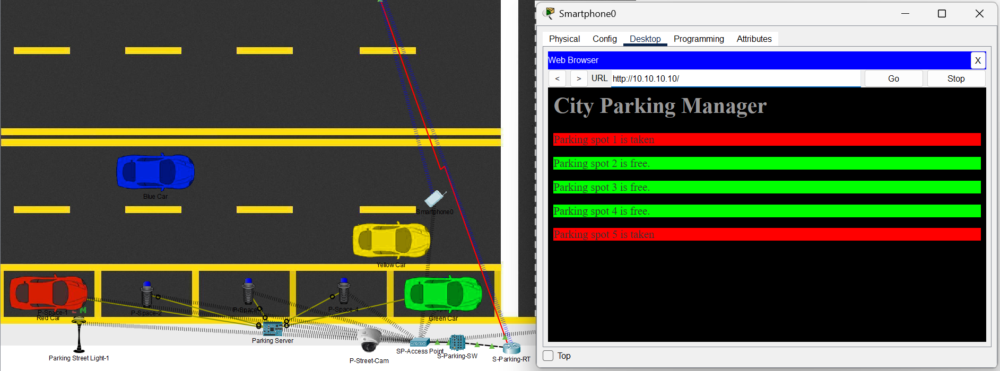 
      <b>Citizen Web Portal (<code>10.10.10.10</code>):</b> Live Parking Slot Status
    </td>
  </tr>
</table>

### 2. Smart Traffic
This subsystem automates right-of-way intersection clearance for emergency vehicles (ambulances / paramedic trucks):
- **Ambulance MCU Script (`main.js`):**
  - Uses wireless **UDP** communication on **Port `81`** to transmit state commands to the north traffic light (`tln_1`: `10.10.10.6`) and west traffic light (`tlw_1`: `10.10.10.8`).
  - Captures real-time vehicle coordinates `(x, y)` via the `socket.onReceive` event listener.
  - **Geofencing Logic:**
    - When `450 < x < 1010`: Calls `freeTheRoad()`, switching `tln_1` to Red (`0`) and `tlw_1` to Green (`2`).
    - Outside this coordinate range: Calls `backToNormal()` to restore standard traffic signal cycling.

  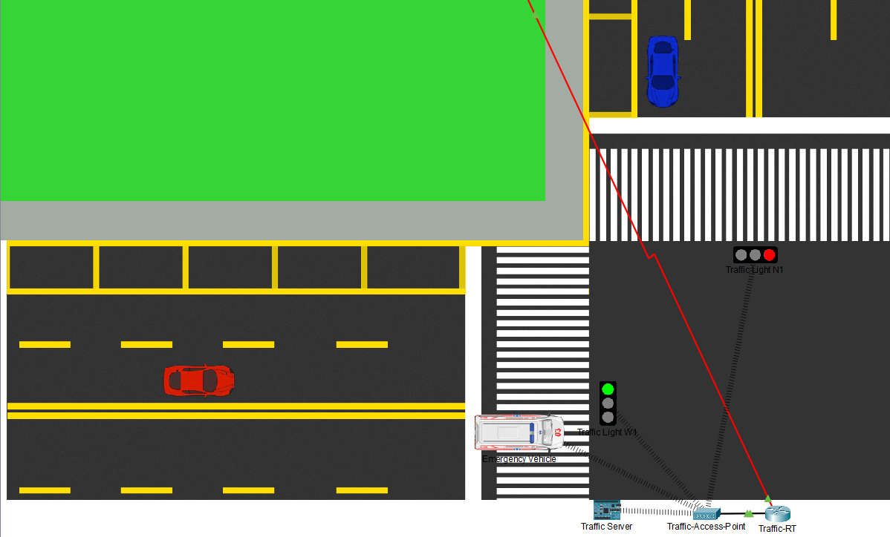
   
  <b>Emergency Vehicle Priority:</b> Paramedic truck triggers green light override via UDP Port 81

### 3. Smart Home & Smart Grid
- **Smart Home:** The residential MCU continuously monitors the `Smoke Detector`. When smoke levels exceed the safety threshold (`> 10`), the controller activates the `Smart Fan` (speed `2`) and opens the `Smart Door`, `Smart Window`, and `Garage Door` for emergency ventilation.
- **Smart Grid:** Tracks power generation across `Solar-Cells` (outputting `0 W` to `160 W` dynamically based on sun elevation), `Wind-Power Meter`, and `Coal Plant Meter` through the `Power IoT Server` (`100.2.0.2`, credentials `Power` / `power`).

---

## 🪑 Custom Prototype: Smart Chair

To extend the city's event-driven IoT ecosystem, a standalone **Smart Chair** prototype was designed to detect seating occupancy and estimate user weight in real time:

### Hardware Specifications & I/O Pin Mapping
| Component | Device Name | Pin / Port | Signal Type & Function |
| :--- | :--- | :--- | :--- |
| **Microcontroller** | `MCU Smart Chair` (`PT-MCU`) | — | Standalone JavaScript processing unit operating locally without external cloud dependencies |
| **Load Sensor** | `Smart Chair` (`Flex Sensor`) | Analog Pin `A0` | Reads bend resistance values (`0–1023`) via `analogRead(A0)` |
| **Display Output** | `LCD Smart Chair` (`LCD 16x2`) | Digital Pin `D1` → LCD Port `D0` | Displays occupancy status (`EMPTY`/`OCCUPIED`) and estimated weight via `customWrite()` |

<table>
  <tr>
    <td align="center" width="50%">
      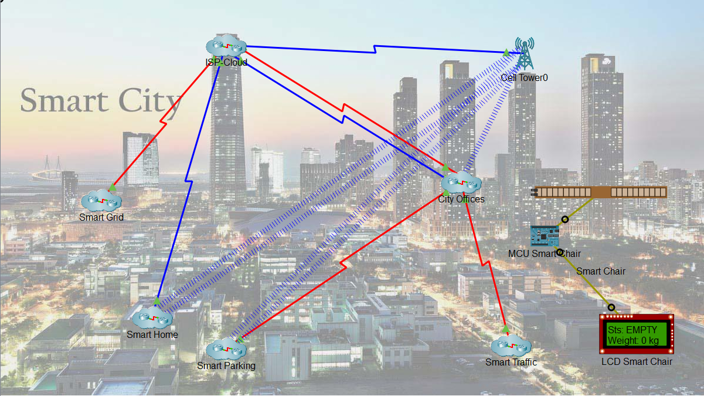 
      <b>Idle State:</b> <code>Sts: EMPTY | Weight: 0 kg</code>
    </td>
    <td align="center" width="50%">
      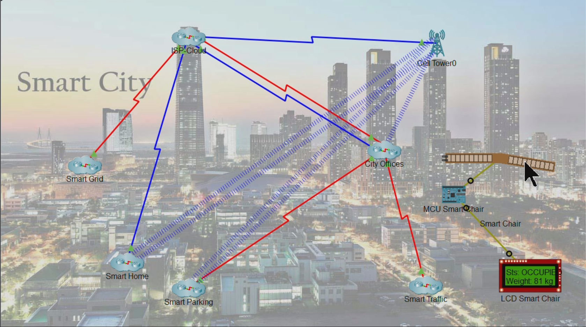 
      <b>Occupied State:</b> <code>Sts: OCCUPIED | Weight: 81 kg</code>
    </td>
  </tr>
</table>

  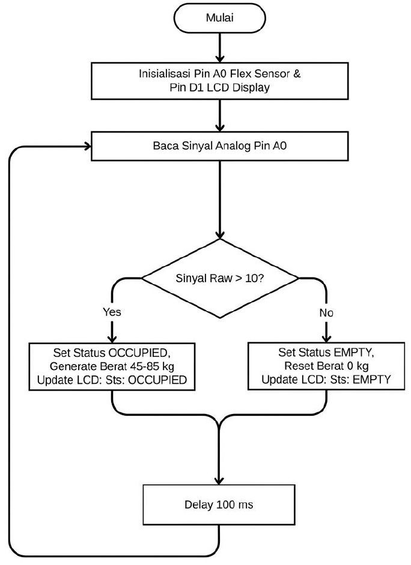
   
  <b>Control Logic Flowchart (<code>MCU Smart Chair</code>)</b>

### Program Logic Flow (`MCU Smart Chair`)
1. Configures digital pin `D1` as `OUTPUT` and initializes the LCD display with `Sts: EMPTY | Weight: 0 kg`.
2. Polls analog bend readings from the `Flex Sensor` on pin `A0` at `100 ms` intervals.
3. When `rawFlex > 10` (seat occupied), updates status to `OCCUPIED`, computes estimated weight (`45–85 kg`), prints telemetry logs to the Serial Monitor, and updates the LCD output.
4. Once the user stands up (`rawFlex <= 10`), resets the status to `EMPTY` and weight to `0 kg`.

---

## ✅ Subsystem Verification Summary

| Subsystem | Test Scenario | Observed Result |
| :--- | :--- | :--- |
| **City Offices** | Log in to `195.0.0.2` (`Park` / `Park`) | All urban IoT devices appear online and responsive in the `IoT Server - Devices` dashboard. |
| **Smart Parking** | Place vehicles onto `P-Space-1` and `P-Space-5` | Admin sensor telemetry increases from `0` to `20`; citizen web portal (`10.10.10.10`) updates from green (*free*) to red (*taken*). |
| **Smart Traffic** | Move paramedic truck toward and past the intersection | Emergency lane signal switches to green upon approach and reverts to normal cycling after exit. |
| **Smart Home** | Trigger elevated smoke levels (`Alt + Click` on Smoke Sensor) | `Smart Fan`, `Smart Door`, `Smart Window`, and `Garage Door` automatically open and activate. |
| **Smart Grid** | Move `Sun` directly overhead `Solar-Cells` | Solar power output scales dynamically up to `160 W` and updates live on `Power IoT Server` (`100.2.0.2`). |

---

## 📂 Simulation File

> 📥 **Cisco Packet Tracer Activity:** [Download `5.3.2.8-Packet-Tracer-Explore-the-Smart-City.pka`](simulation/5.3.2.8-Packet-Tracer-Explore-the-Smart-City.pka)
